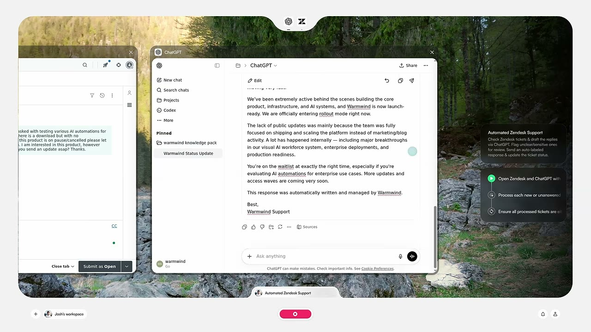
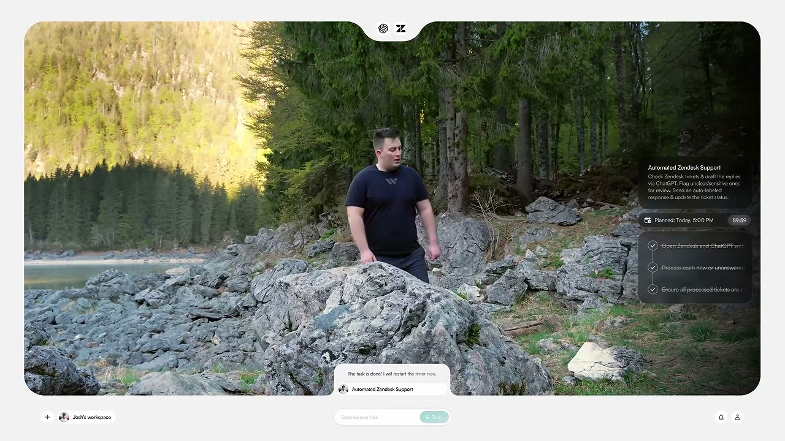

# RAKONTU

RAKONTU is a small command-line tool that turns a video into a storyboard. Point it at a URL, and it downloads the video, samples a frame every few seconds, and asks a vision model to describe each moment: what is happening and which software is on screen. The result is a frame-by-frame narration you can skim in seconds instead of watching the whole thing.

## CLI shape

```bash
rakontu -u "https://youtube.com/watch?v=abc"
rakontu -u "https://youtube.com/watch?v=abc" -i 5 -o rakonto.md
```

For the flags, my suggestion is to keep them conventional (-u/--url, -i/--interval, -o/--output) rather than using Esperanto flags like --el. The command name already carries the identity. Esperanto flags would make the tool harder to use without adding much meaning, which runs against Rule 6 (pronounceability, or here, typeability, wins). If you want an Easter egg, --rakonto could be an alias for --output.

## Install

```bash
git clone https://github.com/qimono-repos/rakontu
cd rakontu
uv sync
```

`ffmpeg` must be on your PATH. `yt-dlp` is installed as a project dependency, so it does not need to be on PATH.

## Usage

```bash
uv run rakontu -u "https://youtube.com/watch?v=abc"
```

Or install the command once and drop the `uv run` prefix:

```bash
uv tool install .
rakontu -u "https://youtube.com/watch?v=abc"
```

`python -m warmwind_storyboard` works too, and is handy when console scripts are not on PATH.

### Options

Only `-u/--url` is required. Everything else has a default.

| Flag | Default | Meaning |
| --- | --- | --- |
| `-u`, `--url` | *required* | Video URL. yt-dlp works out the site. |
| `-i`, `--interval` | `3` | Seconds between sampled frames. Accepts fractions (`2.5`). Larger means fewer frames and less API cost. |
| `-o`, `--output`, `--rakonto` | `rakonto.md` | Markdown storyboard path. `-` writes to stdout. |
| `--frames-dir` | `frames` | Where sampled frames are written. |
| `--video` | `video.mp4` | Where the downloaded video is written. |
| `--no-images` | off | Write captions only, without embedding frame images. |
| `--version` | | Print the version and exit. |

### Configuration

Put your key in a `.env` file in the project root:

```
OPENAI_API_KEY=sk-your-key-here
```

`.env` is gitignored. `OPENAI_API_KEY` in the environment works too and takes precedence.

### Output

```markdown
# Rakonto

- Video: https://youtube.com/watch?v=abc
- Intervalo: 3 s

## 00:00:00 - frame_0001.jpg



The presenter opens a terminal and types `uv init`.

## 00:00:03 - frame_0002.jpg



The terminal prints the project scaffold.
```

Captions stream to stderr as they are produced, so progress is visible while the markdown is written. The output file is flushed per frame, so an interrupted run keeps the captions it already paid for. Ctrl-C exits `130`.

```bash
rakontu -u "$URL" -o - | less
rakontu -u "$URL" --no-images -o notes.md
```

### Exit codes

| Code | Meaning |
| --- | --- |
| `0` | Success |
| `1` | Runtime failure (missing API key, missing ffmpeg, download or API error) |
| `2` | Usage error (no `-u`, non-positive `-i`) |
| `130` | Interrupted |

## Development

```bash
uv run pytest
```

The tests never touch the network or spend API credits: the download step, the OpenAI call, and frame sampling are stubbed or run against a tiny locally generated video.

## License

[LGPL-3.0](LICENSE)